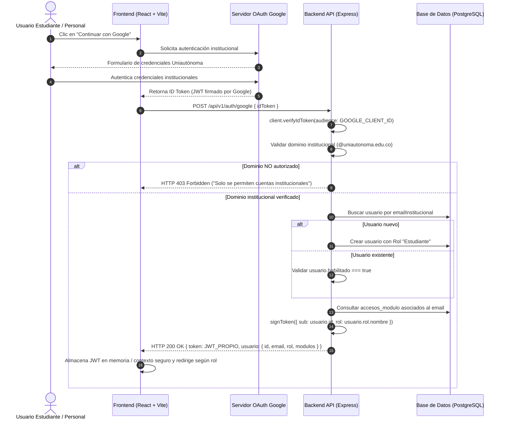
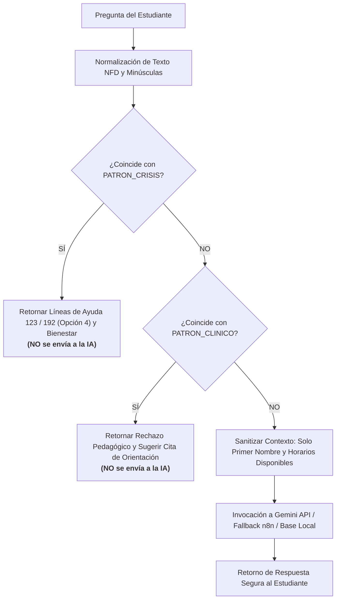

# Sistema de Información Empresarial — Conecta BU
## Anexo F: Modelo de Roles, Permisos y Seguridad del Sistema
### Módulo: Desarrollo Humano y Orientación

---

> **Corporación Universitaria Autónoma del Cauca — Uniautónoma**  
> **Facultad de Ingeniería — Programa de Ingeniería de Sistemas**  
> **Asignatura:** Sistemas de Información Empresarial (SIE)  
> **Periodo Académico:** 2026-2  
> **Proyecto:** Conecta BU — Plataforma Integral de Bienestar Universitario  
> **Autores / Equipo de Desarrollo:**  
> - Luisa Jhulieth Joaqui  
> - Carlos Santiago Torres Castrillón  
> **Identificador del Documento:** `SIE-ANX-F-SEC-2026-2`  
> **Archivo:** `SIE_GrupoXX_Anexo-F_RolesSeguridad.md`  

---

### Control de Versiones

| Versión | Fecha | Autor(es) | Descripción del Cambio | Estado |
| :---: | :---: | :--- | :--- | :---: |
| **1.0.0** | 12/08/2026 | Luisa Joaqui, Carlos Torres | Definición inicial de roles institucionales y esquema de autenticación Google OAuth 2.0. | Aprobado |
| **1.1.0** | 15/09/2026 | Carlos Santiago Torres C. | Incorporación de middlewares RBAC (`authMiddleware`, `requireRole`, `requireModulo`) y políticas de JWT. | Aprobado |
| **1.2.0** | 14/10/2026 | Luisa Jhulieth Joaqui | Adición de filtros de seguridad ética y clínica del Asistente IA (RN-011, HU-012) y Rate Limiting. | Aprobado |
| **1.3.0** | 02/11/2026 | Luisa Joaqui, Carlos Torres | Formalización de matriz de permisos por módulo, políticas de Habeas Data (Ley 1581 de 2012) y mitigación OWASP. | Versión Final |

---

## 1. Introducción y Alcance de Seguridad

El presente documento técnico constituye el **Anexo F: Roles, Permisos y Seguridad** del sistema de información **Conecta BU**, focalizado en el **Módulo de Desarrollo Humano y Orientación**. La plataforma ha sido diseñada bajo una arquitectura orientada a servicios desacoplados por dimensiones de Bienestar Universitario (Desarrollo Humano, Salud Integral, Deporte y Recreación, Arte y Cultura, y Portal Institucional).

El propósito de este anexo es definir formalmente:
1. El modelo de control de acceso basado en roles (**RBAC** - *Role-Based Access Control*) y segregación modular de responsabilidades.
2. Los mecanismos criptográficos y protocolos de autenticación federada (**Google OAuth 2.0** y **JSON Web Tokens - JWT**).
3. La configuración y funcionamiento de la cadena de middlewares de seguridad perimetral e interna.
4. Las matrices detalladas de privilegios funcionales y restricciones de negocio.
5. El marco de gobernanza, privacidad y protección de datos personales conforme al régimen normativo colombiano (**Ley Estatutaria 1581 de 2012**).
6. Los protocolos éticos y salvaguardas algorítmicas implementadas en el asistente conversacional con Inteligencia Artificial.
7. Las políticas de respaldo, tolerancia a fallos y mitigación frente a vulnerabilidades del estándar **OWASP Top 10**.

---

## 2. Modelo de Roles del Sistema

Conecta BU implementa una arquitectura híbrida de **RBAC jerárquico y matricial**. La pertenencia a un rol define la capacidad operativa transversal, mientras que la tabla de asignación modular (`accesos_modulo`) delimita estrictamente el perímetro de acción del personal administrativo, evitando la escalada lateral de privilegios entre áreas de Bienestar.

```mermaid
graph TD
    User([Usuario Institucional]) --> Auth{Autenticación Google OAuth 2.0}
    Auth -->|@uniautonoma.edu.co| RolDecision{Evaluación de Rol y Accesos}
    
    RolDecision -->|Por Defecto| Est[Estudiante]
    RolDecision -->|Asignado en accesos_modulo| Admin[Administrador / Personal de Módulo]
    RolDecision -->|SUPERADMIN_EMAIL| Super[SuperAdministrador]

    subgraph "Perímetro Estudiante"
        Est --> E_DH["/estudiante/* (Desarrollo Humano)"]
        Est --> E_Salud["/mi-salud/*"]
        Est --> E_Dep["/mi-deporte/*"]
        Est --> E_Cult["/mi-cultura/*"]
        Est --> E_SST["/reportes-sst/*"]
    end

    subgraph "Perímetro Administrativo (Segregado)"
        Admin -->|acceso: desarrollo-humano| ADM_DH["/admin/* (Agenda, Talleres, Horarios, Métricas)"]
        Admin -->|acceso: salud| ADM_Salud["/salud/* (Atenciones, SNIES, Ficha Médica)"]
        Admin -->|acceso: deporte| ADM_Dep["/deporte/* (Grupos, Horas, Asistencia)"]
        Admin -->|acceso: cultura| ADM_Cult["/cultura/* (Talleres, Audiciones, Agenda)"]
    end

    subgraph "Perímetro de Gobernanza Global"
        Super --> S_Panel["/super/* (Gestión Usuarios, Asignación Módulos, Informes Consolidados)"]
    end
```

### 2.1. Rol: Estudiante
* **Identificador en BD:** Rol `Estudiante`.
* **Descripción y Propósito:** Asignado automáticamente a todo miembro de la comunidad universitaria que accede por primera vez con su correo institucional. Representa al usuario consumidor final de los servicios de Bienestar Universitario.
* **Perímetro de Acceso (Rutas):**
  - Módulo Desarrollo Humano: `/estudiante/*` (consulta de catálogo de orientación psicológica, agendamiento de citas individuales, consulta y cancelación de citas propias, exploración de talleres/eventos, autogestión de inscripciones y uso del Asistente IA).
  - Otros módulos de Bienestar: `/mi-salud/*` (solicitud de citas de salud), `/mi-deporte/*` (inscripción a disciplinas y seguimiento de horas acumuladas), `/mi-cultura/*` (talleres artísticos y convocatorias), `/reportes-sst/*` (registro de salidas institucionales y condiciones de seguridad).
* **Restricción Clave:** No puede consultar agendas globales, notas del personal, citas de otros estudiantes ni acceder a paneles administrativos de backoffice.

### 2.2. Rol: Administrador (Personal de Módulo)
* **Identificador en BD:** Rol `Administrador`.
* **Descripción y Propósito:** Corresponde a los funcionarios, profesionales y coordinadores operativos de Bienestar Universitario. Su alcance no es global: está estrictamente circunscrito a los módulos que le hayan sido delegados explícitamente mediante la entidad `accesoModulo`.
* **Aislamiento Modular en Desarrollo Humano:**
  - El personal acreditado con el módulo `desarrollo-humano` accede de forma exclusiva a `/admin/*`.
  - Puede parametrizar servicios de orientación psicológica, definir franjas horarias y bloqueos temporales de agenda, consultar la agenda consolidada de citas, asentar la asistencia, registrar atenciones inmediatas sin cita previa (*walk-in*), crear y publicar eventos o talleres institucionales, gestionar el aforo, verificar asistencia mediante lectura de código QR y generar reportes analíticos consolidados.
* **Mecanismo de Segregación:** Si un Administrador de Desarrollo Humano intenta invocar endpoints o navegar hacia `/salud/*`, `/deporte/*` o `/cultura/*`, el backend bloquea la petición con un error HTTP `403 Forbidden` (`SIN_ACCESO_MODULO`), haciendo efectivo el principio de mínimo privilegio.

### 2.3. Rol: SuperAdministrador
* **Identificador en BD:** Rol `SuperAdministrador`.
* **Descripción y Propósito:** Máxima autoridad de gobernanza técnica y funcional del ecosistema Conecta BU. Encargado de la supervisión global de usuarios y la asignación de responsabilidades a los administradores de área.
* **Perímetro de Acceso (Rutas):**
  - Panel exclusivo: `/super/*`.
  - Gestión integral de usuarios: `/super/usuarios` (búsqueda, visualización de trazabilidad, habilitación/deshabilitación de cuentas, modificación manual de roles).
  - Delegación de accesos: `/super/accesos` (vinculación de correos institucionales a dimensiones específicas: `desarrollo-humano`, `salud`, `deporte`, `cultura`).
  - Consolidación institucional: `/super/informes` (tableros generales e indicadores transversales de gestión de Bienestar).
* **Separación de Operaciones:** Por diseño de arquitectura, el SuperAdministrador gestiona el sistema desde su panel centralizado de gobernanza; no interactúa como operador de citas de orientación clínica para preservar el secreto profesional y la confidencialidad de la atención psicológica.

---

## 3. Mecanismo de Autenticación y Autorización

Conecta BU prescinde de repositorios locales de credenciales y contraseñas propietarias, mitigando completamente los riesgos asociados a filtración de hashes, ataques de fuerza bruta y reutilización de contraseñas.



### 3.1. Flujo Criptográfico de Autenticación Federada (Google OAuth 2.0)
1. **Captura del Token:** En la capa de presentación (`@react-oauth/google`), el usuario autentica su identidad frente al proveedor de identidad de Google Workspace institucional.
2. **Recepción del ID Token:** El frontend obtiene un ID Token criptográficamente firmado por Google y lo remite mediante transporte seguro HTTPS al endpoint `POST /api/v1/auth/google`.
3. **Verificación en Servidor:** La función `verifyGoogleIdToken` utiliza la biblioteca oficial `google-auth-library` (`OAuth2Client`). Se valida la validez temporal del token, la firma con las claves públicas rotativas de Google y la concordancia del parámetro `audience` contra `config.googleClientId`.
4. **Validación Estricta de Dominio (`RN-001` / `HU-001`):** La rutina `verificarDominioInstitucional` extrae el correo verificado (`email_verified !== false`) y comprueba que el sufijo de dominio coincida exactamente con la variable de entorno `ALLOWED_GOOGLE_DOMAIN` (`uniautonoma.edu.co`). Todo intento de inicio con cuentas comerciales (`@gmail.com`) o externas es denegado con código HTTP `403`.
5. **Aprovisionamiento y Sincronización:**
   - Si el usuario no existe, la base de datos ejecuta un aprovisionamiento dinámico asignando por defecto el rol `Estudiante`.
   - Se ejecuta `aplicarAccesos`: si el correo posee registros activos en `accesoModulo`, el rol se actualiza a `Administrador` y se anexan los códigos de módulo autorizados.
   - Si el usuario coincide con `SUPERADMIN_EMAIL`, el sistema garantiza en tiempo de ejecución la pertenencia al rol `SuperAdministrador`.
6. **Emisión de JWT Propietario:** El backend genera un token de sesión propio utilizando la biblioteca `jsonwebtoken`, firmado mediante el secreto simétrico de alta entropía `JWT_SECRET` (`HS256`) y con expiración controlada (`JWT_EXPIRES_IN`).

### 3.2. Estructura y Protección del JWT Interno
El payload del token emitido por Conecta BU cumple con el principio de minimización de datos:
```json
{
  "sub": "550e8400-e29b-41d4-a716-446655440000",
  "rol": "Estudiante",
  "iat": 1794787200,
  "exp": 1794873600
}
```
> [!IMPORTANT]
> El token JWT **no almacena** contraseñas, documentos de identidad, notas clínicas ni direcciones IP. El identificador del sujeto (`sub`) enlaza directamente a la clave primaria del usuario en PostgreSQL, impidiendo la exposición innecesaria de atributos personales en el cliente.

### 3.3. Cadena de Middlewares de Seguridad

Toda solicitud que acceda a la API REST de Conecta BU debe superar una serie de filtros secuenciales e independientes:

```
[ Solicitud HTTP Entrante ]
            │
            ▼
    ┌────────────────┐
    │     Helmet     │ ──> Inyecta cabeceras HTTP de seguridad (CSP, HSTS, X-Frame-Options)
    └────────────────┘
            │
            ▼
    ┌────────────────┐
    │  CORS Policy   │ ──> Valida origen exacto (FRONTEND_URL) y cabeceras expuestas
    └────────────────┘
            │
            ▼
    ┌────────────────┐
    │ Rate Limiting  │ ──> Ventana de control anti-abuso (límiteLogin / límiteAsistente)
    └────────────────┘
            │
            ▼
    ┌────────────────┐
    │ authMiddleware │ ──> Verifica firma JWT, vigencia y estado en BD (habilitado: true)
    └────────────────┘
            │
            ▼
    ┌────────────────┐
    │  requireRole   │ ──> Comprueba pertenencia al Rol requerido (ej. Administrador)
    └────────────────┘
            │
            ▼
    ┌────────────────┐
    │ requireModulo  │ ──> Valida asignación en accesos_modulo ("desarrollo-humano")
    └────────────────┘
            │
            ▼
[ Controlador de Negocio ]
```

#### A. Middleware de Autenticación (`auth.middleware.js`)
* Extrae el encabezado `Authorization: Bearer <token>`.
* Valida la firma y expiración del JWT.
* **Consulta en Tiempo Real de Habilitación:** Ejecuta una consulta a la base de datos para obtener el estado actual del usuario. Si `usuario.habilitado === false`, aborta inmediatamente con HTTP `401 Unauthorized` ("Tu usuario no tiene acceso habilitado en Conecta BU"). Esto garantiza la **revocación inmediata de accesos**, sin depender de la expiración pasiva del token.
* Resuelve dinámicamente la lista de módulos habilitados en `usuario.modulos` e inyecta la entidad en `req.usuario`.

#### B. Middlewares de Autorización (`roles.middleware.js`)
* `requireRole(...rolesPermitidos)`: Comprueba que el rol del usuario figure en la lista autorizada. De lo contrario, emite HTTP `403 Forbidden`.
* `requireModulo(modulo)`: Especializado en la segregación modular. Verifica que el módulo solicitado forme parte del conjunto asignado al usuario. En caso de discrepancia, arroja HTTP `403` con código de error `SIN_ACCESO_MODULO`. Impide asimismo el ingreso de SuperAdministradores a la lógica clínica interna de los módulos (`SUPERADMIN_SIN_MODULOS`).

#### C. Control de Tasa de Peticiones (`rateLimit.middleware.js`)
* `limiteLogin`: Aplica una ventana fija en memoria de 15 minutos con un umbral máximo de 20 peticiones por dirección IP para salvaguardar el endpoint de autenticación.
* `limiteAsistente`: Configurado para proteger la cuota de la API del modelo de lenguaje y prevenir la denegación de servicio. Establece un límite de 20 peticiones cada 5 minutos.
* **Clave de Limitación Discriminada:** El limitador del asistente se indexa prioritariamente por el identificador de usuario autenticado (`req.usuario?.id`) y no por la IP. Esta decisión arquitectónica es crítica, puesto que cientos de estudiantes navegan simultáneamente desde las mismas direcciones IP públicas del campus universitario.

#### D. Protección Perimetral: Helmet y CORS (`app.js`)
* **Helmet:** Establece cabeceras de seguridad que mitigan ataques comunes en aplicaciones web:
  - `Content-Security-Policy` (CSP): Restringe los dominios autorizados para scripts, imágenes y fuentes.
  - `X-Frame-Options: DENY`: Previene ataques de Clickjacking.
  - `X-Content-Type-Options: nosniff`: Evita que el navegador intente adivinar el tipo MIME de archivos cargados.
  - `Strict-Transport-Security` (HSTS): Fuerza el uso exclusivo del protocolo seguro HTTPS.
* **CORS:** Configurado estrictamente para aceptar solicitudes únicamente provenientes de la URL establecida en `FRONTEND_URL` con soporte de credenciales (`credentials: true`), exponiendo de manera controlada las cabeceras `Content-Disposition` y `X-Actividades-Sin-Responsable`.

---

## 4. Matriz de Permisos (RBAC) — Desarrollo Humano

La siguiente matriz detalla de forma exhaustiva las capacidades operativas en el **Módulo de Desarrollo Humano y Orientación**, contrastando el perfil del Estudiante, el Administrador del módulo y el SuperAdministrador, junto con el endpoint de API asociado y el middleware de control exigido.

| # | Función / Operación del Sistema | Estudiante | Admin DH | SuperAdmin | Endpoint / Ruta de API | Middleware de Control |
|---|---|:---:|:---:|:---:|---|---|
| **1** | Ver catálogo de servicios de orientación | **✓** | **✓** | **✓** | `GET /api/v1/servicios` | `authMiddleware` |
| **2** | Ver horarios disponibles de atención | **✓** | **✓** | **✓** | `GET /api/v1/citas/disponibles` | `authMiddleware` |
| **3** | Agendar cita de orientación psicológica | **✓** | **✗** | **✗** | `POST /api/v1/citas` | `authMiddleware`, `requireRole('Estudiante')` |
| **4** | Consultar citas propias del usuario | **✓** | **✗** | **✗** | `GET /api/v1/citas/mis-citas` | `authMiddleware`, `requireRole('Estudiante')` |
| **5** | Cancelar cita propia (anticipación > 24 h) | **✓** | **✗** | **✗** | `PATCH /api/v1/citas/:id/cancelar` | `authMiddleware`, `RN-004` en servicio |
| **6** | Ver eventos institucionales publicados | **✓** | **✓** | **✓** | `GET /api/v1/eventos` | `authMiddleware` |
| **7** | Inscribirse a taller o evento abierto | **✓** | **✗** | **✗** | `POST /api/v1/eventos/:id/inscripciones` | `authMiddleware`, `requireRole('Estudiante')` |
| **8** | Cancelar inscripción a evento propio | **✓** | **✗** | **✗** | `DELETE /api/v1/eventos/:id/inscripciones` | `authMiddleware`, `requireRole('Estudiante')` |
| **9** | Interactuar con Asistente Virtual IA | **✓** | **✓** | **✓** | `POST /api/v1/asistente/consultas` | `authMiddleware`, `limiteAsistente` |
| **10** | Crear, editar y deshabilitar horarios | **✗** | **✓** | **✓** | `POST, PUT, DELETE /api/v1/admin/horarios` | `authMiddleware`, `requireRole('Administrador', 'SuperAdministrador')` |
| **11** | Crear bloqueos temporales de agenda | **✗** | **✓** | **✓** | `POST /api/v1/admin/horarios/bloqueos` | `authMiddleware`, `requireRole('Administrador', 'SuperAdministrador')` |
| **12** | Visualizar agenda consolidada de citas | **✗** | **✓** | **✓** | `GET /api/v1/admin/citas` | `authMiddleware`, `requireRole('Administrador', 'SuperAdministrador')` |
| **13** | Registrar asistencia a cita (Asistió/No) | **✗** | **✓** | **✓** | `PATCH /api/v1/admin/citas/:id/asistencia` | `authMiddleware`, `requireRole('Administrador', 'SuperAdministrador')` |
| **14** | Registrar atención espontánea sin cita previa | **✗** | **✓** | **✓** | `POST /api/v1/admin/citas/atencion-inmediata`| `authMiddleware`, `requireRole('Administrador', 'SuperAdministrador')` |
| **15** | Crear, publicar, editar y eliminar eventos | **✗** | **✓** | **✓** | `POST, PUT, DELETE /api/v1/admin/eventos` | `authMiddleware`, `requireRole('Administrador', 'SuperAdministrador')` |
| **16** | Ver listado consolidado de inscritos a evento| **✗** | **✓** | **✓** | `GET /api/v1/admin/eventos/:id/inscritos` | `authMiddleware`, `requireRole('Administrador', 'SuperAdministrador')` |
| **17** | Registrar asistencia manual a evento | **✗** | **✓** | **✓** | `POST /api/v1/admin/eventos/:id/asistencia` | `authMiddleware`, `requireRole('Administrador', 'SuperAdministrador')` |
| **18** | Generar y controlar código QR de asistencia | **✗** | **✓** | **✓** | `GET, POST /api/v1/admin/eventos/:id/qr` | `authMiddleware`, `requireRole('Administrador', 'SuperAdministrador')` |
| **19** | Ver métricas analíticas y tablero de control| **✗** | **✓** | **✓** | `GET /api/v1/admin/estadisticas` | `authMiddleware`, `requireRole('Administrador', 'SuperAdministrador')` |
| **20** | Descargar reportes institucionales (Excel/PDF)| **✗** | **✓** | **✓** | `GET /api/v1/admin/estadisticas/reporte` | `authMiddleware`, `requireRole('Administrador', 'SuperAdministrador')` |
| **21** | Modificar roles y habilitación de usuarios | **✗** | **✗** | **✓** | `PATCH /api/v1/admin/usuarios/:id` | `authMiddleware`, `requireRole('SuperAdministrador')` |
| **22** | Asignar y revocar módulos al personal | **✗** | **✗** | **✓** | `POST, DELETE /api/v1/super/accesos` | `authMiddleware`, `requireRole('SuperAdministrador')` |

> [!NOTE]
> La cancelación de citas por parte del estudiante exige un plazo mínimo de 24 horas (`config.horasMinimasCancelacion = 24`). Si el estudiante intenta cancelar con menor anticipación, el servicio rechaza la transacción con código `400 Bad Request`, obligando a contactar directamente a la dependencia para reasignar la franja.

---

## 5. Reglas de Seguridad en la Lógica de Negocio

El sistema aplica invariantes de seguridad directamente en la capa de servicios del backend (`UsuarioService`, `AccesoService`, `AsistenteService`, `CitaService`):

### 5.1. Inmutabilidad de la Propia Cuenta (`noEsElMismo`)
Ningún usuario autenticado, con independencia de su jerarquía (incluso un SuperAdministrador), puede modificar su propio rol en el sistema ni auto-deshabilitar su cuenta (`adminId === usuarioId`). Esto previene bloqueos accidentales de acceso administrativo y asegura la trazabilidad de cambios por terceros.

### 5.2. Principio de Disponibilidad Administrativa (`exigirOtroSuper`)
El sistema valida que siempre exista al menos un SuperAdministrador y un Administrador con estado habilitado en la plataforma. Cualquier intento de deshabilitar o degradar al último administrador activo desencadena una excepción HTTP `409 Conflict` con el mensaje: *"Debe quedar al menos un superadministrador habilitado en Conecta BU"*.

### 5.3. Revocación Inmediata de Sesiones
A diferencia de arquitecturas basadas exclusivamente en la expiración estática de tokens, Conecta BU verifica el atributo `usuario.habilitado` en cada petición protegida mediante `auth.middleware.js`. Cuando un usuario es marcado como inhabilitado en la base de datos, cualquier token activo emitido previamente queda inmediatamente invalidado en la siguiente transacción.

### 5.4. Segregación y Privacidad en Notificaciones Automáticas (`n8n`)
El sistema integra webhooks hacia la plataforma de automatización `n8n` para notificar agendamientos, cancelaciones y recordatorios (RF-013). La regla de negocio estipula que:
- Los eventos remitidos (`cita.agendada`, `cita.cancelada`, `evento.publicado`) incluyen únicamente identificadores opacos, nombres de pila, fecha, hora y servicio.
- **Queda estrictamente prohibido** enviar motivos de consulta, notas de orientación o antecedentes personales a los webhooks de notificación.
- Las fallas de conexión con `n8n` no interrumpen la persistencia de las citas o inscripciones en PostgreSQL.

### 5.5. Salvaguardas Éticas y Clínicas del Asistente IA (`RF-014` / `RN-011`)
El Asistente Virtual de Orientación incorpora un pipeline de seguridad en cascada que opera **antes** de consultar modelos de lenguaje externos (Gemini o n8n):



1. **Detección Preventiva de Crisis:** Mediante expresiones regulares sobre texto normalizado (`PATRON_CRISIS`), se detectan patrones de ideación suicida o autolesión. La ejecución se intercepta localmente, devolviendo de inmediato las líneas de emergencia de Colombia (Línea 123 y Línea 192 opción 4) y la recomendación de acudir de urgencia a Bienestar Universitario. El texto **jamás se envía a la IA**.
2. **Bloqueo de Consultas Clínicas y Farmacológicas:** Mediante `PATRON_CLINICO`, se interceptan preguntas sobre diagnósticos psicológicos, medicamentos, tratamientos o dosificaciones. El sistema responde con una negativa estandarizada indicando que el asistente no es un profesional de la salud mental y orienta al estudiante a agendar una cita presencial.
3. **Ofuscación de Identidad:** La llamada a la API de Gemini (`AsistenteService.consultarGemini`) omite el correo institucional, apellidos, cédula y género del estudiante. Únicamente se envía el primer nombre y la relación de horarios y eventos públicos.
4. **No Persistencia del Chat:** Las interacciones del chat residen transitoriamente en el estado de React del frontend; el backend no almacena el historial de conversaciones en la base de datos relacional.

---

## 6. Manejo de Información Sensible y Datos Personales

### 6.1. Marco Legal: Ley Estatutaria 1581 de 2012 (Habeas Data)
El tratamiento de datos dentro de Conecta BU se rige estrictamente por la legislación colombiana de protección de datos personales (**Ley 1581 de 2012** y Decreto Reglamentario 1377 de 2013).

* **Principio de Finalidad:** Los datos personales capturados se limitan exclusivamente a gestionar el acompañamiento integral, la participación en actividades de Bienestar y la emisión de reportes estadísticos agregados ante el Ministerio de Educación Nacional (SNIES y SPADIEZ).
* **Principio de Libertad:** El estudiante autoriza el tratamiento de sus datos institucionales al momento de autenticarse voluntariamente mediante Google OAuth institucional.
* **Principio de Veracidad y Calidad:** La información de nombre y correo institucional se sincroniza directamente con el directorio oficial de la Uniautónoma.
* **Principio de Acceso y Circulación Restringida:** Los datos de orientación psicológica solo son visibles por el personal acreditado de Desarrollo Humano. No se comparten entre módulos ni se exponen a terceros.

### 6.2. Clasificación de Datos Tratados en Desarrollo Humano

| Categoría de Dato | Atributos Específicos | Nivel de Sensibilidad | Mecanismo de Protección |
|---|---|:---:|---|
| **Identificación Institucional** | Nombre completo, correo `@uniautonoma.edu.co`, ID de usuario | General | Almacenamiento en PostgreSQL, transporte HTTPS, JWT firmado. |
| **Roles y Autorización** | Rol asignado (`Estudiante`, `Administrador`), permisos modulares | Restringido | Verificación obligatoria en cada petición vía middleware. |
| **Gestión de Agenda** | Horarios reservados, fecha y hora de citas, asistencia | Privado | Visibilidad acotada al propio estudiante y al personal de DH. |
| **Información Clínica / Diagnóstica** | Diagnósticos, notas psiquiátricas, prescripción de fármacos | **Sensible (Prohibido)** | **NO se almacena en el módulo de Desarrollo Humano**. Se canaliza por canales clínicos externos o registros reservados de Salud bajo custodia estricta. |
| **Conversaciones IA** | Preguntas formuladas al asistente virtual | Transitorio | **No persistente**. Almacenamiento volátil en cliente; se descarta al cerrar sesión. |

### 6.3. Almacenamiento y Protección de Evidencias y Archivos
* La carga de adjuntos (imágenes de eventos, documentos SST, evidencias institucionales) es gestionada mediante **Multer**, restringiendo el almacenamiento físico al directorio local del servidor (`backend/uploads/`).
* **Reglas de Aislamiento de Archivos:**
  - Límite de tamaño estricto (`SALUD_MAX_EVIDENCIA_MB` o 5 MB por archivo).
  - Validación de extensiones permitidas (`image/jpeg`, `image/png`, `image/webp`, `application/pdf`).
  - Nombres de archivo ofuscados con marcas temporales y hashes aleatorios para evitar colisiones y ejecución de scripts maliciosos.
  - El directorio de cargas no posee permisos de ejecución en el sistema de archivos del servidor.

---

## 7. Políticas de Acceso, Sesión y Red

### 7.1. Ciclo de Vida de la Sesión
* **Generación:** Se inicia tras la respuesta exitosa de Google OAuth y la firma del JWT interno.
* **Vigencia:** El JWT tiene una vida útil limitada parametrizada en la variable de entorno `JWT_EXPIRES_IN` (por defecto `24h` para entornos operativos universitarios).
* **Cierre de Sesión Seguro:** Al accionar el botón de cierre de sesión en la interfaz web, el frontend elimina el token almacenado en memoria/almacenamiento local, eliminando cualquier vector de reutilización en la terminal compartida del campus.
* **Inactivación Forzada:** Si un usuario es inhabilitado por el SuperAdministrador, el backend interrumpe la sesión en la solicitud inmediatamente posterior.

### 7.2. Resolución de Direcciones IP Detrás de Proxies Inversos
Dado que el backend se despliega comúnmente detrás de proxies inversos o balanceadores de carga (Render, Nginx), se implementa la configuración `app.set("trust proxy", ...)` gobernada por la variable de entorno `TRUST_PROXY`. Esto garantiza que:
- La cabecera `X-Forwarded-For` sea interpretada con precisión.
- La variable `req.ip` refleje la dirección IP pública real del cliente y no la del proxy del servidor web.
- Los limitadores de tasa (`rateLimit.middleware.js`) operen correctamente sin unificar a la totalidad de los usuarios bajo la IP del clúster.

---

## 8. Políticas de Respaldo y Continuidad Operativa

### 8.1. Estrategia en Entornos de Desarrollo Local
* El entorno de ingeniería opera sobre **PostgreSQL 16** orquestado mediante `docker-compose`.
* La persistencia de datos descansa sobre volúmenes gestionados por Docker.
* No se contemplan esquemas de replicación automática continua en desarrollo; los datos de prueba y esquemas estructurales se reestablecen mediante migraciones declarativas de **Prisma ORM** (`prisma migrate dev`) y semillas de datos (`prisma/seed.js`).

### 8.2. Estrategia Sugerida para Entornos de Producción (Supabase / Render)
Para el despliegue final institucional de Conecta BU en infraestructura gestionada en la nube:
1. **Copias de Seguridad Automatizadas Diarias:** Configuración de respaldos completos diarios gestionados automáticamente por el proveedor de base de datos (Supabase / Render PostgreSQL), con una retención mínima de 7 a 30 días.
2. **Recuperación a un Punto en el Tiempo (PITR):** Habilitación del registro de transacciones (*Write-Ahead Logging* - WAL) para permitir la restauración de la base de datos a un instante específico ante errores humanos o incidentes de corrupción de datos.
3. **Procedimiento de Restauración:** Protocolo de restauración semestral probado en un entorno réplica (*staging*) para certificar un **RTO** (*Recovery Time Objective*) inferior a 2 horas y un **RPO** (*Recovery Point Objective*) inferior a 24 horas.

### 8.3. Gestión Segura de Credenciales y Secretos
* **Exclusión de Control de Versiones:** Los archivos de variables de entorno (`.env`, `.env.production`) se encuentran explícitamente incorporados en la directiva `.gitignore`. Queda terminantemente prohibido versionar secretos criptográficos en el repositorio de Git.
* **Inyección en Tiempo de Ejecución:** En producción, las variables críticas (`DATABASE_URL`, `JWT_SECRET`, `GOOGLE_CLIENT_ID`, `GEMINI_API_KEY`, `N8N_SECRET`) se configuran directamente en el panel de gestión del proveedor de nube bajo variables de entorno cifradas en reposo.

---

## 9. Matriz de Vulnerabilidades Conocidas y Mitigaciones (OWASP Top 10)

La siguiente matriz documenta el análisis de riesgos y los controles de mitigación implementados en el Módulo de Desarrollo Humano con base en el estándar internacional de seguridad en aplicaciones web **OWASP Top 10**:

| Código OWASP | Categoría de Vulnerabilidad | Vector de Ataque en el Proyecto | Mecanismo de Mitigación Implementado en Conecta BU |
|:---:|---|---|---|
| **A01:2021** | **Broken Access Control** (Pérdida de Control de Acceso) | Un estudiante intenta acceder a la agenda del psicólogo (`/api/v1/admin/citas`) o cancelar la cita de otro estudiante. | Doble capa de validación: `requireRole('Administrador')` en endpoints administrativos y validación en servicio (`cita.usuarioId === usuario.id`) para operaciones sobre citas propias. |
| **A02:2021** | **Cryptographic Failures** (Fallas Criptográficas) | Interceptación de tokens de sesión en tránsito o uso de algoritmos débiles. | Forzado de transporte seguro HTTPS mediante Helmet (HSTS). Emisión de JWT firmados con HMAC-SHA256 y secreto criptográfico de alta entropía (`JWT_SECRET`). |
| **A03:2021** | **Injection** (Inyecciones SQL / Comandos) | Manipulación de campos de búsqueda o parámetros de ruta para alterar consultas en base de datos. | Uso exclusivo de **Prisma ORM**, que implementa consultas preparadas y parametrizadas automáticas, neutralizando ataques de inyección SQL. |
| **A04:2021** | **Insecure Design** (Diseño Inseguro) | Bloqueo o deshabilitación del único administrador, provocando indisponibilidad de gestión. | Implementación de invariantes de negocio: funciones `noEsElMismo` y `exigirOtroSuper` que prohíben auto-mutaciones y vaciado de administradores. |
| **A05:2021** | **Security Misconfiguration** (Configuración Defectuosa) | Exposición de cabeceras de depuración o aceptación de peticiones de cualquier dominio. | Uso de **Helmet** para sanitizar cabeceras HTTP y política **CORS** restrictiva vinculada unívocamente a `FRONTEND_URL`. |
| **A06:2021** | **Vulnerable and Outdated Components** | Uso de dependencias desactualizadas con vulnerabilidades conocidas en Node.js. | Verificación periódica mediante `npm audit`. Uso de bibliotecas maduras y oficiales (`google-auth-library`, `@prisma/client`, `helmet`). |
| **A07:2021** | **Identification and Authentication Failures** | Ataques de fuerza bruta sobre contraseñas o suplantación de identidad. | Eliminación de contraseñas locales. Autenticación delegada en **Google OAuth 2.0** institucional con validación obligatoria de dominio. |
| **A08:2021** | **Software and Data Integrity Failures** | Consumo de respuestas alteradas de la IA o webhooks manipulados. | Validación del payload de Google con claves públicas del proveedor. Verificación de esquemas de respuesta en `AsistenteService` y webhooks de `n8n`. |
| **A09:2021** | **Security Logging and Monitoring Failures** | Ausencia de registro de peticiones críticas y eventos de error. | Integración de **Morgan** para registro de tráfico HTTP y middleware centralizado de manejo de errores (`errorHandler`) con códigos de estado semánticos. |
| **A10:2021** | **Server-Side Request Forgery / Abuse (SSRF / DoS)** | Agotamiento de cuota de la API de Gemini mediante peticiones automatizadas continuas. | Implementación de `limiteAsistente` (Rate Limit) por usuario autenticado (`req.usuario.id`) y timeout estricto con `AbortController` en peticiones hacia Gemini y n8n. |

---

## 10. Conclusiones y Recomendaciones de Seguridad

1. **Aislamiento Robusto:** La combinación del modelo RBAC y la delegación granular mediante `accesos_modulo` asegura que el personal de Desarrollo Humano cuente con las herramientas necesarias para la gestión de citas y talleres, sin comprometer las bases de datos ni historiales médicos del módulo de Salud Integral o de otras dependencias.
2. **Defensa en Profundidad:** La seguridad de Conecta BU opera en múltiples capas: perimetral (CORS, Helmet, Rate Limiting), transporte (HTTPS, OAuth 2.0), sesión (JWT, validación en BD en tiempo real) y lógica de negocio (invariantes de autoservicio y filtros éticos del asistente).
3. **Privacidad y Cumplimiento:** El módulo de Desarrollo Humano respeta la privacidad estudiantil al no almacenar datos clínicos en la plataforma web y garantizar la no persistencia de las consultas formuladas a la inteligencia artificial, en concordancia con el marco legal colombiano de Habeas Data.

---
*Fin del documento — Anexo F: Roles, Permisos y Seguridad.*
