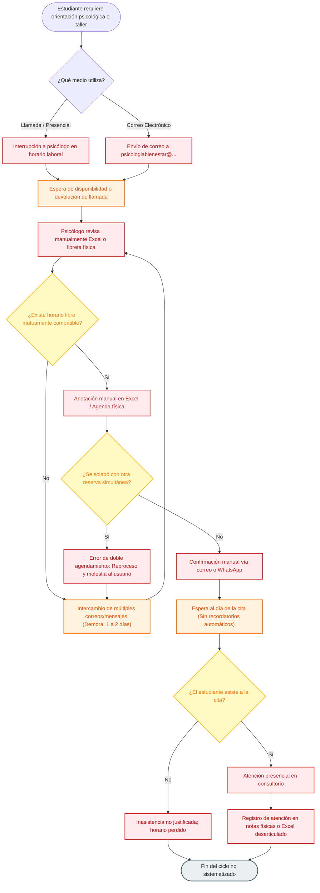
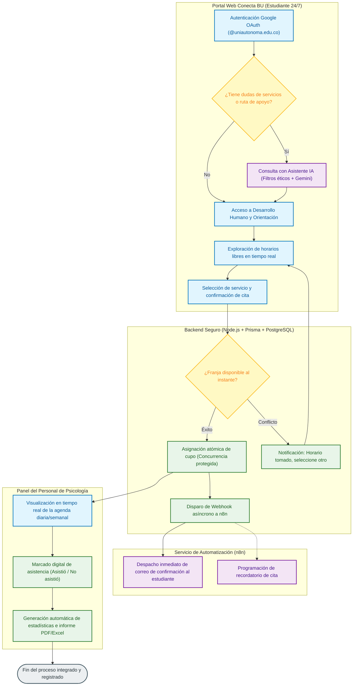

# Anexo G: Impacto en el Proceso de Negocio
## Módulo de Desarrollo Humano y Orientación — Conecta BU

---

### Portada y Control del Documento

| **Elemento** | **Información Detallada** |
|---|---|
| **Institución** | Corporación Universitaria Autónoma del Cauca (Uniautónoma) |
| **Dependencia** | Unidad de Bienestar Universitario |
| **Programa Académico** | Ingeniería de Sistemas — Sistemas de Información Empresarial (SIE) |
| **Proyecto** | Conecta BU — Plataforma Web de Gestión para Bienestar Universitario |
| **Módulo Evaluado** | Desarrollo Humano y Orientación Psicológica |
| **Cliente / Stakeholder** | Psic. Ancizar Paz — Coordinador del Área de Psicología |
| **Equipo de Trabajo** | Luisa Jhulieth Joaqui   Carlos Santiago Torres Castrillón |
| **Periodo Académico** | 2026-2 |
| **Fecha de Emisión** | Noviembre de 2026 |
| **Estado del Documento** | Versión Oficial Entregada |

---

### Registro de Control de Versiones

| Versión | Fecha | Autor(es) | Descripción del Cambio / Alcance | Aprobación |
|:---:|:---:|---|---|:---:|
| **1.0.0** | 15/11/2026 | Luisa Jhulieth Joaqui, Carlos Santiago Torres | Versión inicial consolidada del Anexo G: análisis AS-IS, TO-BE, indicadores cuantitativos, beneficios, matriz de riesgos y conclusiones de impacto institucional. | Ancizar Paz |

---

## 1. Introducción y Propósito del Documento

El presente documento constituye el **Anexo G: Impacto en el Proceso de Negocio**, formulado en el marco de la asignatura Sistemas de Información Empresarial (SIE). Su propósito es presentar una evaluación rigurosa y multidimensional de la transformación operativa ocurrida en el **Área de Psicología y Acompañamiento Estudiantil** (adscrita al módulo de Desarrollo Humano de Bienestar Universitario en la Universidad Autónoma), a partir del diseño, despliegue y puesta en marcha de la plataforma web **Conecta BU**.

La transición de un modelo tradicional basado en interacciones dispersas (correos electrónicos, mensajería instantánea no estructurada, agendas físicas y hojas de cálculo desarticuladas) hacia un ecosistema digital transaccional, con soporte automatizado mediante flujos en **n8n**, analítica en tiempo real y asistencia conversacional ética mediante **Gemini API**, ha generado un impacto sustancial tanto en los indicadores de eficiencia administrativa como en la calidad y oportunidad de la atención recibida por los estudiantes.

---

## 2. Descripción del Proceso Operativo Tradicional (Situación AS-IS)

Antes de la implementación de Conecta BU, la gestión de los servicios de Desarrollo Humano operaba mediante procedimientos altamente manuales, fragmentados y dependientes de la intermediación continua del personal asistencial y administrativo. 

### 2.1 Subprocesos Identificados en el Modelo AS-IS

1. **Solicitud y Agendamiento de Citas de Orientación:**
   - El estudiante con necesidad de orientación psicológica debía redactar un correo electrónico a la cuenta institucional de psicología o realizar una llamada telefónica en horario de oficina.
   - El personal de psicología debía suspender sus labores de consulta o redacción para responder, verificar manualmente la disponibilidad en un archivo Excel o agenda física, y proponer franjas horarias.
   - Se presentaba una recurrente "triangulación de mensajes" (el estudiante proponía una hora, el psicólogo no podía, se proponía otra hora), tardando entre 10 y 30 minutos por cita, o incluso dilatándose durante días en caso de correos no leídos oportunamente.
   - Existía una alta probabilidad de **doble asignación de citas (overbooking)** cuando dos profesionales o funcionarios anotaban compromisos sobre el mismo bloque temporal.

2. **Difusión y Registro en Talleres y Eventos de Bienestar:**
   - La divulgación se limitaba a carteleras institucionales en pasillos y cadenas informales de WhatsApp.
   - El control de cupos se efectuaba manualmente mediante listados en papel o formularios de Google sin validación de aforo concurrente, provocando sobrecupo en talleres con límites físicos de sala.
   - Los estudiantes debían hacer filas o diligenciar listas físicas al ingresar al taller, generando retrasos de inicio y caligrafías ilegibles.

3. **Verificación y Control de Asistencia:**
   - En las citas individuales, la confirmación de asistencia se anotaba en notas sueltas o se olvidaba registrar, imposibilitando el seguimiento del índice de inasistencias (*no-show*).
   - En los eventos masivos, las planillas físicas de papel se archivaban en carpetas, con alto riesgo de deterioro, extravío o transcripción deficiente.

4. **Consolidación de Estadísticas y Reportería Semestral:**
   - Al finalizar el periodo académico (2026-2), el personal debía dedicar entre dos y cuatro jornadas laborales completas a revisar correos, consolidar filas en Excel y calcular sumatorias manuales de usuarios atendidos, tipos de servicio y coberturas para el Sistema Nacional de Información de la Educación Superior (SNIES) y el informe de gestión institucional.
   - Los errores humanos de cálculo eran frecuentes y no existía visibilidad del rendimiento del área a mitad de semestre.

5. **Atención a Consultas Frecuentes:**
   - Estudiantes con dudas operativas básicas (horarios de atención, requisitos de cita, ubicación de consultorios) tocaban a la puerta de los consultorios, interrumpiendo sesiones confidenciales en curso o saturando la línea telefónica.

---

### 2.2 Diagrama de Flujo del Proceso AS-IS (Manual y Fragmentado)

A continuación se ilustra el flujo tradicional que debía recorrer un estudiante para agendar una cita o participar en un evento, evidenciando los puntos de fricción, demoras y reprocesos:

---

## 3. Descripción del Proceso Modernizado (Situación TO-BE)

Con la implementación de **Conecta BU**, el proceso de negocio del módulo de Desarrollo Humano fue completamente rediseñado bajo una arquitectura orientada a servicios, responsiva, segura y centrada en la autonomía del usuario.

### 3.1 Innovaciones Clave en el Modelo TO-BE

1. **Autoservicio Digital de Citas 24/7:**
   - El estudiante ingresa con su cuenta institucional mediante **Google OAuth** (`@uniautonoma.edu.co`).
   - Visualiza en tiempo real los bloques horarios habilitados por los profesionales de psicología. Solo se muestran franjas disponibles a partir de la fecha actual.
   - Reserva su cita con dos clics, con validación de una única cita activa de orientación para garantizar equidad en la cobertura.

2. **Garantía Transaccional Atómica (Cero Solapamientos):**
   - El backend implementa transacciones atómicas a nivel de base de datos relacional (PostgreSQL / Prisma ORM). En caso de que dos estudiantes intenten seleccionar el mismo horario de manera simultánea, el motor bloquea el registro en el milisegundo exacto y preserva la integridad, impidiendo de raíz el doble agendamiento.

3. **Orquestación de Notificaciones Desacopladas (n8n):**
   - Al confirmarse o cancelarse una cita, el backend dispara de forma asíncrona webhooks a **n8n**.
   - El flujo procesa el evento y envía notificaciones formales por correo electrónico sin exponer datos clínicos confidenciales, manteniendo la alta disponibilidad del sistema principal aunque el despachador de correos experimente latencias.

4. **Gestión Integral de Agenda y Bloqueos para el Personal:**
   - El psicólogo cuenta con un panel administrativo donde define sus franjas de atención por semana o por horas individuales.
   - Cuenta con la función **"No estaré disponible"**, permitiendo bloquear periodos por comisiones institucionales, licencias, capacitaciones o descansos, eliminando citas en horarios no operables.
   - Dispone de la función de atención espontánea para registrar a estudiantes que llegan de urgencia sin cita previa, integrándolos transparentemente a la estadística.

5. **Inscripción Inteligente a Talleres y Control de Asistencia por QR:**
   - Los talleres cuentan con aforo máximo controlado automáticamente a nivel de base de datos; al completarse el límite, el sistema bloquea inscripciones y notifica "Sin cupos".
   - El registro de asistencia en eventos se agiliza radicalmente mediante códigos QR y códigos dinámicos por sesión generados desde el panel del instructor, reduciendo la toma de lista de 15 minutos a pocos segundos.

6. **Asistente IA de Orientación Ética y Segura (Gemini API):**
   - Un agente conversacional entrenado responde dudas frecuentes 24/7 sobre trámites, rutas de atención, horarios y servicios.
   - Cuenta con una arquitectura de protección multinivel: si el estudiante consulta sobre diagnósticos, medicación o autolesión, el sistema activa un cortafuegos ético instantáneo que bloquea el envío al modelo, desplegando los teléfonos de auxilio nacional (Líneas 123 y 192 opción 4) y orientando a la atención presencial inmediata en Bienestar.

7. **Tablero de Analítica y Reportería Automática:**
   - Las citas atendidas, canceladas, inasistencias y talleres se computan en tiempo real en un dashboard gráfico.
   - El personal y la dirección generan el consolidado semestral en formato Excel o PDF con un solo clic, listo para reportes de autoevaluación y SNIES.

---

### 3.2 Diagrama de Flujo del Proceso TO-BE (Digitalizado e Integrado)

---

## 4. Comparación Exhaustiva: Proceso AS-IS vs. Proceso TO-BE

La siguiente tabla sintetiza la transformación operativa experimentada por cada uno de los subprocesos de negocio pertenecientes al área de Desarrollo Humano:

| Subproceso de Negocio | Situación Anterior (AS-IS) | Situación Actual con Conecta BU (TO-BE) | Transformación Operativa Clave |
|---|---|---|---|
| **1. Autenticación y Acceso al Servicio** | Sin validación digital. Contacto telefónico o presencial en oficina requiriendo verificar manualmente la condición de estudiante activo. | Autenticación federada mediante **Google OAuth** restringida exclusivamente al dominio `@uniautonoma.edu.co`. | Eliminación de registros manuales y usurpación de identidad; aprovisionamiento automático de rol estudiante. |
| **2. Consulta de Disponibilidad de Citas** | Opaca e indirecta. El estudiante dependía de la respuesta por correo o teléfono del psicólogo para conocer los días y horas libres. | Transparente e inmediata. Catálogo interactivo de horarios disponibles actualizado al segundo desde cualquier dispositivo móvil o de escritorio. | Reducción de la asimetría de información; empoderamiento total del usuario en la toma de decisiones. |
| **3. Agendamiento de Citas** | Lento y fragmentado. Proceso de intercambio de mensajes que tomaba entre 10 y 30 minutos (o días en caso de desfase en respuestas). | Ágil y autónomo. Selección y confirmación de la cita en menos de 3 minutos, sin mediación de terceros. | Agilidad operativa extrema; ahorro de tiempo administrativo para psicólogos y estudiantes. |
| **4. Integridad en Asignación de Cupos** | Vulnerable. Riesgo frecuente de doble asignación de citas (overbooking) al gestionar agendas concurrentes en papel o Excel compartido. | Absoluta. Aislamiento transaccional con bloqueos atómicos en PostgreSQL vía Prisma ORM; cero margen para solapamientos. | Fiabilidad técnica del 100%; erradicación de fricciones y cancelaciones forzadas por cruces de agenda. |
| **5. Cancelación y Liberación de Horarios** | Ineficiente. Avisos tardíos por WhatsApp o inasistencias sin previo aviso; la franja quedaba perdida sin poder ofrecerse a otro estudiante. | Controlada por regla de negocio (RN). Cancelación en autoservicio permitida con más de 24 horas de antelación, liberando el bloque al instante. | Optimización del aprovechamiento de las horas de consultorio; respeto a la disponibilidad del profesional. |
| **6. Notificaciones y Recordatorios** | Redacción manual de correos o mensajes directos por WhatsApp, demandando tiempo del personal y sujeta a olvidos. | Despacho automático de notificaciones vía webhooks con **n8n** en eventos de agendamiento, cancelación o recordatorio. | Comunicación estandarizada, institucional y desacoplada del hilo transaccional principal. |
| **7. Difusión e Inscripción a Talleres** | Carteleras físicas y difusión informal en chats. Listas de papel sin control de aforo en tiempo real, provocando sobrecupo en salas. | Publicación estructurada con detalle (modalidad virtual/presencial, fotos, enlaces) y control atómico de aforo en base de datos. | Aforo garantizado según capacidad física de salas; experiencia de usuario moderna y atractiva. |
| **8. Control de Asistencia a Citas y Eventos** | Registro en hojas volantes o cuadernos; caligrafía ilegible, pérdida física de soportes y dificultad de trazabilidad. | Registro digital con un clic en panel administrativo y asistencia rápida mediante código QR y códigos dinámicos por sesión. | Trazabilidad exacta con marca de tiempo, usuario y correo; cero extravío de información. |
| **9. Gestión de Horarios y Contingencias** | Anotaciones al margen en libretas. Dificultad para coordinar ausencias imprevistas por incapacidad, comisión o permiso. | Módulo de **Bloqueos ("No estaré disponible")** y habilitación dinámica de franjas por semana o por hora en el panel admin. | Flexibilidad operativa para los psicólogos sin alterar citas preexistentes consolidadas. |
| **10. Atención a Consultas Frecuentes** | Interrupciones continuas a consultas presenciales o llamadas insistentes para resolver dudas rutinarias de bienestar. | **Asistente IA 24/7** basado en Gemini API con base de conocimiento local de contingencia y filtros de contención psicológica inmediata. | Atención ininterrumpida; canalización adecuada de emergencias a líneas 123/192 y descongestión de consultorios. |
| **11. Generación de Estadísticas y Reportería** | Tabulación manual al final del semestre; requería entre 16 y 40 horas hombre recopilando y cuadrando cifras para el SNIES. | Tablero de analítica en tiempo real (dashboard interactivo) y exportación de informes en Excel y PDF en menos de 5 segundos. | Disponibilidad inmediata de datos para toma de decisiones y acreditación institucional de alta calidad. |

---

## 5. Indicadores Cuantitativos de Mejora

A efectos de medir formalmente el impacto organizacional generado por Conecta BU en el Área de Desarrollo Humano, se establecieron indicadores de desempeño (KPIs) comparando la línea base (AS-IS) contra la operación sobre la plataforma (TO-BE):

| Métrica / Dimensión de Rendimiento | Situación Anterior (Línea Base AS-IS) | Situación Actual (Conecta BU TO-BE) | Factor de Impacto / Mejora | Justificación Operativa y Técnica |
|---|:---:|:---:|:---:|---|
| **Tiempo promedio de agendamiento de cita** | 10 a 30 minutos (sujeto a demoras de hasta 48 h) | **< 3 minutos** | **Reducción del 85% al 90%** en tiempo activo de gestión | El autoservicio elimina la cadena de triangulación telefónica y por correo electrónico. |
| **Tasa de errores por doble agendamiento** | Estimada en 5% a 15% de las reservas mensuales | **0% (Cero errores)** | **100% de eliminación** de solapamientos | El motor transaccional atómico de PostgreSQL/Prisma impide la reserva concurrente del mismo registro. |
| **Tiempo de generación de informe semestral** | 16 a 40 horas hombre (2 a 5 días hábiles de trabajo) | **< 5 segundos** | **Reducción del 99.9%** del esfuerzo | Las consultas agregadas en base de datos consolidan citas, atenciones y asistencias instantáneamente. |
| **Disponibilidad horaria para agendar citas** | 40 horas / semana (exclusivamente en jornada laboral) | **168 horas / semana (24/7)** | **+320% de incremento** en disponibilidad | Acceso web público continuo desde cualquier navegador, permitiendo al estudiante agendar en noches o fines de semana. |
| **Tiempo de respuesta a preguntas frecuentes** | 2 a 48 horas (dependiente de horario hábil) | **Inmediato (< 3 segundos)** | **Reducción > 99%** en tiempo de espera | El asistente virtual IA atiende en milisegundos las 24 horas del día sin intervención humana. |
| **Tasa de sobrecupo en talleres y eventos** | Frecuente (10% a 20% de eventos con exceso de aforo) | **0% (Físicamente imposible)** | **100% de control** de capacidad | Validación estricta a nivel de API: la transacción rechaza solicitudes cuando `inscritos >= cupo_maximo`. |
| **Tiempo de registro de asistencia a eventos** | 45 a 60 segundos por estudiante en planilla física | **< 5 segundos** por estudiante con QR | **Reducción del 90%** en tiempos de fila | Escaneo digital instantáneo que actualiza el estado `ASISTIO` en la base de datos centralizada. |
| **Tasa de inasistencia no avisada (*No-Show*)** | 25% a 35% por falta de recordatorio y desorganización | **Reducción estimada al 10% - 15%** | **Mejora del ~50%** en efectividad de asistencia | Regla de cancelación anticipada (24 h) combinada con notificaciones automatizadas enviadas por n8n. |

---

## 6. Beneficios Cualitativos del Sistema

Más allá de los incrementos medibles en velocidad y exactitud numérica, Conecta BU aporta un conjunto de ventajas cualitativas fundamentales para la cultura y clima organizacional de la Uniautónoma:

### 6.1 Beneficios para los Estudiantes
- **Confidencialidad, Intimidad y Reducción del Estigma:** Muchos estudiantes con afecciones emocionales o dificultades personales evitaban acercarse a las oficinas físicas de Bienestar o llamar por teléfono por temor a ser juzgados o expuestos ante sus compañeros. El agendamiento autónomo y privado desde su propio dispositivo fomenta la búsqueda oportuna de ayuda psicológica profesional.
- **Equidad y Transparencia en el Acceso:** Todos los estudiantes acceden a las mismas franjas horarias en igualdad de condiciones, eliminando preferencias subjetivas o desinformación sobre qué servicios están activos.
- **Canal Seguro de Apoyo Emocional Inicial:** El asistente IA no busca fungir como terapeuta clínico, pero brinda una orientación clara, amable y pedagógica, educando al estudiante sobre las funciones de Bienestar y ofreciendo rutas claras y números de emergencia institucional y nacional en momentos de crisis.

### 6.2 Beneficios para el Personal Asistencial (Psicólogos y Coordinación)
- **Dignificación del Rol Profesional:** Los profesionales de la psicología se formaron para brindar contención, diagnóstico psicosocial e intervención humana, no para ejercer labores secretariales de contestación de llamadas, transcripción de listas o cuadre manual de agendas. Conecta BU les devuelve hasta un 25% de su tiempo laboral para enfocarlo en la atención directa a los casos críticos.
- **Ambiente de Consulta Protegido y Silencioso:** Se eliminaron las constantes interrupciones a la puerta de los consultorios para preguntar "¿A qué hora atiende el psicólogo?", preservando el encuadre terapéutico y el respeto por la privacidad del paciente en sesión.
- **Trazabilidad y Organización Histórica:** Capacidad inmediata de consultar el histórico de atenciones de un estudiante, verificar si es reincidente y contar con un registro ordenado sin lidiar con montañas de papel.

### 6.3 Beneficios para la Institución y la Dirección de Bienestar
- **Cultura de Decisiones Basadas en Datos (Data-Driven):** La dirección de la universidad puede visualizar qué días y servicios presentan mayor demanda (ej. orientación vocacional, apoyo en duelo, técnicas de estudio), permitiendo reasignar recursos, contratar profesionales de apoyo o diseñar talleres preventivos con base en evidencias reales y no en suposiciones.
- **Alineación con Estándares de Acreditación de Alta Calidad:** Cumplimiento ejemplar de los lineamientos del Consejo Nacional de Acreditación (CNA) y del Ministerio de Educación Nacional respecto a los sistemas integrados de información para la permanencia estudiantil y el bienestar universitario.

---

## 7. Matriz de Riesgos Identificados y Estrategias de Mitigación

La introducción de un sistema de información en un entorno asistencial universitario conlleva desafíos operativos, tecnológicos y humanos. A continuación se presenta la matriz de riesgos gestionada en el diseño de Conecta BU:

| Código | Riesgo Identificado | Nivel de Impacto | Probabilidad | Estrategia de Mitigación Implementada en Conecta BU |
|:---:|---|:---:|:---:|---|
| **R-01** | **Uso indebido del Asistente IA en situaciones de crisis extrema o ideación suicida.** Un estudiante podría intentar recibir terapia crítica o tratamiento farmacológico a través del chat automatizado. | **Crítico** | Media | **Filtros Éticos y Reglas Clínicas de Bloqueo Previo (RN-011):** El backend inspecciona los mensajes antes de invocar la IA externa. Si detecta intenciones de daño o términos clínicos/medicamentosos, bloquea la consulta hacia el modelo y despliega una pantalla de emergencia prioritaria con las líneas de auxilio 123 y 192 (opción 4), además de exigir el contacto presencial inmediato en Bienestar. |
| **R-02** | **Fallas en la entrega de correos de notificación o indisponibilidad del motor n8n.** Si el servicio n8n experimenta caídas, los correos podrían perderse. | **Medio** | Baja | **Arquitectura Desacoplada y Resiliente (HU-011):** El backend procesa y confirma la cita a nivel de base de datos independientemente del estado de n8n. Si el webhook falla, la transacción no se reversa, asegurando el cupo del estudiante. Adicionalmente, el estudiante siempre puede consultar sus citas en el módulo "Mis Citas". |
| **R-03** | **Violación de privacidad o fuga de datos sensibles de historias clínicas.** Riesgo de exposición de anotaciones confidenciales de las sesiones de orientación psicológica. | **Crítico** | Muy Baja | **Aislamiento de Dominio y Cumplimiento Legal (Habeas Data):** Conecta BU **no almacena historias clínicas ni expedientes psicoterapéuticos**. El sistema gestiona exclusivamente el agendamiento y la asistencia administrativa (asistió/no asistió). La reserva se cifra y solo el personal autorizado tiene acceso a las agendas del módulo. |
| **R-04** | **Resistencia al cambio o brecha tecnológica en usuarios tradicionales.** Resistencia de ciertos estudiantes o administrativos a utilizar la plataforma digital. | **Bajo** | Media | **Diseño Centrado en el Usuario (UX/UI Accesible y Minimalista):** Flujos intuitivos de tres pasos, autenticación con un clic mediante Google OAuth institucional sin necesidad de recordar contraseñas adicionales, y manual de usuario detallado en lenguaje claro. |
| **R-05** | **Ausentismo estudiantil a citas reservadas (*No-Show*).** Estudiantes que agendan franjas y no asisten, bloqueando el acceso a otros compañeros. | **Medio** | Alta | **Regla de Cancelación con +24 Horas y Registro de Inasistencia:** Se educa al estudiante mediante el sistema, permitiendo cancelar oportunamente para liberar el cupo. En el panel administrativo se registra la inasistencia formal, permitiendo a la coordinación identificar conductas reiterativas y reprogramar políticas de atención. |

---

## 8. Conclusiones y Proyecciones Futuras

1. **Transformación Digital Integral y Medible:** La implementación del módulo de Desarrollo Humano de Conecta BU ha demostrado que la digitalización no es un mero cambio de soporte documental, sino una reingeniería profunda del proceso de atención estudiantil. Se han reducido los tiempos de espera de 30 minutos a menos de 3 minutos, con una disponibilidad ampliada a 24 horas al día, 7 días a la semana.
2. **Eficiencia y Cero Errores Transaccionales:** La erradicación total de cruces de agenda y sobrecupos gracias al control atómico en base de datos proporciona tranquilidad tanto a los profesionales de la psicología como a los estudiantes, garantizando que cada cita agendada representa un espacio seguro, disponible y respetado.
3. **Liberación de Carga Administrativa y Calidad Asistencial:** El personal de psicología se ha liberado de decenas de horas mensuales de labores mecánicas (tabulación de encuestas, cuadre de hojas de cálculo, redacción manual de notificaciones), pudiendo enfocar su talento y vocación en el acompañamiento humano, la salud mental comunitaria y la prevención de la deserción académica.
4. **Escalabilidad y Base Sólida para Bienestar Universitario:** El éxito probado en el módulo de Desarrollo Humano valida la arquitectura multi-módulo de Conecta BU, estableciendo el estándar técnico y de gobernanza de datos para la consolidación definitiva de los módulos complementarios de Salud Integral, Deporte y Recreación, y Arte y Cultura en toda la Universidad Autónoma.

---

> [!NOTE]
> **Fin del Documento — Anexo G**  
> Documento elaborado en conformidad con las especificaciones de entrega de proyectos de software académico para la Corporación Universitaria Autónoma del Cauca, Periodo 2026-2.
