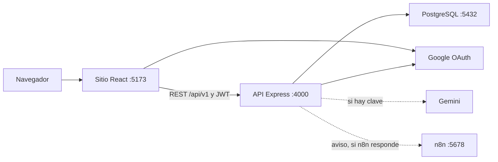
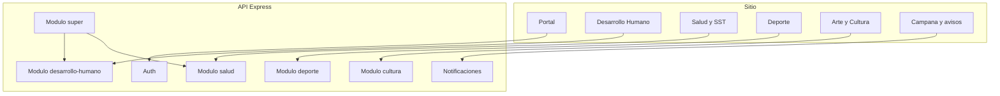
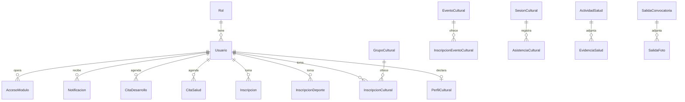

# Manual técnico y de arquitectura — Conecta BU

Describe cómo está armado Conecta BU en el repositorio `main`, commit `dbe4f07` (10 de noviembre de 2026). El ambiente que existe es el de desarrollo en un computador. No hay infraestructura publicada.

## 1. Patrón

Conecta BU es un **monolito modular**: un sitio y una API, en dos procesos, partidos por dimensión de Bienestar. No es una malla de microservicios. Cada módulo vive en su carpeta y se monta en `backend/src/app.js`, pero comparten proceso, base de datos y despliegue.

Tampoco es Clean Architecture al pie de la letra. No hay un anillo de puertos y adaptadores en todos los módulos. El estilo real es de **capas**, con dos variantes:

- **Rutas y servicio.** Desarrollo Humano, Deporte, Cultura, autenticación y notificaciones: la ruta HTTP llama un servicio y el servicio habla con Prisma.
- **Controlador, servicio y repositorio.** Salud se parece más a MVC en capas: el controlador recibe la petición, el servicio aplica la regla y el repositorio lee o escribe.

El navegador es una sola aplicación React. No hay una aplicación de tienda.

## 2. Stack

| Capa | Tecnología | Versión en el repositorio |
|---|---|---|
| Interfaz | React y React Router | React 18.3, Router 6.26 |
| Empaquetado | Vite | 5.4 |
| Estilos | Tailwind CSS | 3.4 |
| Gráficas y movimiento | Recharts, Motion, Three, Leaflet | Según `frontend/package.json` |
| API | Node.js y Express | Express 4.19 |
| Seguridad HTTP | Helmet, CORS limitado al origen del sitio | Helmet 7 |
| Acceso a datos | Prisma | 5.22 en el cliente generado; el paquete declara ^5.18 |
| Base | PostgreSQL | 16 en `docker-compose.yml` |
| Identidad | Google Identity Services y JWT propio | `google-auth-library` 9, `jsonwebtoken` 9 |
| Archivos | Multer, en disco local | Hasta 5 MB en Cultura; Salud tiene su propio tope |
| Informes | ExcelJS y PDFKit | Hojas SNIES, constancias e informes de gestión |
| Automatización | n8n | Imagen 2.42.7, puerto 5678 |
| Modelo de lenguaje | Gemini, solo si hay clave en el servidor | La clave no va en el repositorio |
| Pruebas | Jest y Supertest | Jest 29 |

Zona horaria de negocio: América/Bogotá. El periodo académico es `AAAA-1` de enero a junio y `AAAA-2` de julio a diciembre.

## 3. Infraestructura que sí está desplegada

Solo en el computador de desarrollo, con `docker compose up -d` para los dos servicios de apoyo:

| Pieza | Dónde corre | Puerto | Persistencia |
|---|---|---|---|
| Sitio (Vite en desarrollo) | Proceso `npm run dev` | 5173 | No aplica |
| API (Express) | Proceso `npm run dev` | 4000 | Carpeta local de cargas |
| PostgreSQL 16 | Contenedor `postgres` | 5432 | Volumen `conecta_bu_pgdata` |
| n8n | Contenedor | 5678 | Volumen `conecta_bu_n8n` |

La API ya contempla un proxy (`TRUST_PROXY`) para cuando haya Nginx o un servicio como Render. Ese proxy **no está instalado**. No hay Dockerfile de la aplicación, ni pipeline, ni dominio, ni certificado, ni copia de seguridad diaria.

Google OAuth está autorizado para `http://localhost:5173`. Un origen público exigiría registrarlo de nuevo en Google Cloud.

Variables que el servidor necesita y que no se versionan: `DATABASE_URL`, `JWT_SECRET`, `GOOGLE_CLIENT_ID`, `ALLOWED_GOOGLE_DOMAIN`, `FRONTEND_URL`. Opcionales: `GEMINI_API_KEY`, `SUPERADMIN_EMAIL`, datos SMTP y el secreto de n8n.

## 4. Diagrama de despliegue

La línea punteada significa que la cita, la inscripción o el aviso se guardan aunque n8n o Gemini no contesten.

## 5. Diagrama de componentes

Rutas principales montadas en `backend/src/app.js`:

| Prefijo | Módulo |
|---|---|
| `/api/v1/auth` | Sesión |
| `/api/v1/notificaciones` | Campana, para cualquier rol |
| `/api/v1/servicios`, `/citas`, `/eventos`, `/asistente` | Estudiante de Desarrollo Humano |
| `/api/v1/admin/...` | Personal de Desarrollo Humano |
| `/api/v1/salud/...` | Salud, estudiante y personal |
| `/api/v1/reportes-sst` | Salidas y SST, cualquier cuenta institucional |
| `/api/v1/deporte` y `/deporte/admin` | Deporte |
| `/api/v1/cultura`, `/cultura/admin`, `/cultura/publico` | Arte y Cultura |
| `/api/v1/super` y `/admin/usuarios` | Superadministrador |

## 6. Diagrama de datos

No es el esquema completo (Prisma tiene más de cuarenta modelos). Es el núcleo que une a la persona con cada dimensión.

Reglas que viven en el servicio, no solo en la tabla:

- El correo debe ser `@uniautonoma.edu.co`. El primer ingreso crea el usuario como Estudiante.
- El personal entra a un módulo solo si su correo está en `AccesoModulo`. El superadministrador no entra a esos paneles: asigna accesos.
- Cultura añade un papel operativo (`administrador`, `docente` o `monitor`). Si no hay fila, cuenta como administrador.
- El tipo SNIES de Cultura (1 estudiante, 2 docente, 3 administrativo, 4 egresado) es un dato del perfil, no el rol de la cuenta. Salud numera esos tipos distinto; el Excel de Cultura lo advierte.
- Cada inscripción y cada asistencia de Cultura guardan usuario, hora e IP.

## 7. Flujo de una petición

1. El sitio guarda el JWT en `localStorage` con la clave `conectabu_token`.
2. Axios lo envía en `Authorization`.
3. `authMiddleware` verifica la firma y carga el usuario.
4. `requireRole` exige Estudiante o Administrador. `requireModulo` exige el acceso de esa dimensión.
5. El servicio valida cupos, cruces de horario y estados. Prisma escribe en PostgreSQL.
6. Si la operación debe avisar, se llama a n8n. Si n8n falla, la operación ya guardada no se deshace.
7. El manejador de errores convierte un `AppError` en el JSON `{ message }` y el código HTTP (400, 401, 403, 404 o 409).

## 8. Qué queda fuera de esta arquitectura

- Permanencia estudiantil no tiene módulo. En el portal dice «Próximamente».
- No hay videollamada, historia clínica, diagnóstico ni aplicación nativa.
- No hay colas, ni bus de eventos, ni una base por módulo. Una sola PostgreSQL sirve a todas las dimensiones.
